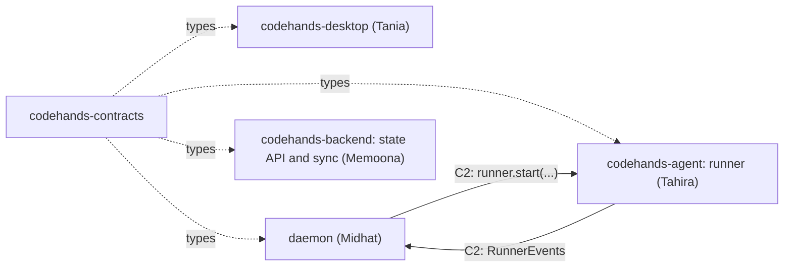
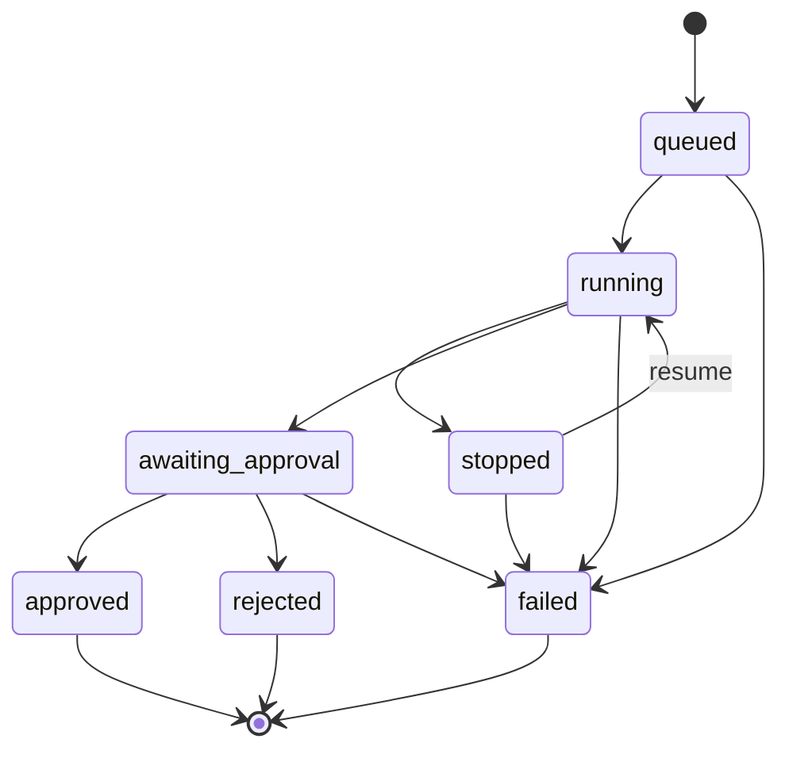

# codehands-contracts

The shapes every Code Hands AI repo agrees on: session rows, session statuses and the legal moves between them, runner events, and the `Runner` interface.

This package holds types plus a few small constants and helpers. There is no runtime logic here. It exists so the parts can be built in separate repos by separate people and still fit together on Friday.

**Owners:** Midhat and Tahira. Every repo that uses a contract approves changes to it.
**Status:** v0.1.0, proposed Mon Oct 19 and frozen Fri Oct 23, 2026.
**Part of:** [Code Hands AI](https://github.com/devweekends/codehands-docs). Read the design in that README first.

## Why it exists

Code Hands AI is split into one repo per part ([decision 0001](https://github.com/devweekends/codehands-docs/blob/main/decisions/0001-separate-repos.md)). Separate repos only work if every shape two repos share is written down in one place, typed and versioned. That place is this repo.



## What is in v0.1.0

| File | Exports | Used by |
| --- | --- | --- |
| [src/session.ts](src/session.ts) | `SessionStatus`, `AgentKind`, `CommandKind`, `Device`, `Project`, `Session`, `Command`, `SESSION_TRANSITIONS`, `canTransition()` | Everyone |
| [src/runner.ts](src/runner.ts) | `RUNNER_EVENT_TYPES`, `RunnerEventType`, `RunnerEvent`, `StartOptions`, `Runner` | The daemon and the runner |
| [src/index.ts](src/index.ts) | Re-exports both files | |

### Session statuses

A session is one task on one repo. It has exactly seven statuses, and only the moves below are legal. `canTransition(from, to)` is the single check every repo uses, so the runner, the daemon and the apps can never disagree about what may happen next.



| Status | Meaning |
| --- | --- |
| `queued` | Created, not started yet |
| `running` | The agent is working in its own worktree |
| `stopped` | Stopped by a person. The worktree is kept so it can resume |
| `awaiting_approval` | The agent finished. A change is waiting for a person |
| `approved` | The change was committed on the task's branch. Final |
| `rejected` | The change was thrown away, worktree and branch deleted. Final |
| `failed` | Something went wrong. The reason is on the `task.failed` event. Final |

```ts
import { canTransition } from "@codehands/contracts";

canTransition("running", "awaiting_approval"); // true
canTransition("running", "approved");          // false: approve only after the agent finished
```

### Runner events

The runner turns whatever the agent CLI prints into a stream of `RunnerEvent`s. The daemon stores them and the apps draw them.

```ts
interface RunnerEvent {
  sessionId: string;
  seq: number;          // 1, 2, 3 … per session, never reused, continues after a resume
  type: RunnerEventType;
  at: string;           // ISO time
  payload: Record<string, unknown>;
  raw?: unknown;        // the agent's original line, untouched
}
```

`seq` is what makes a resend harmless: a reader that already has event 14 ignores a second event 14, and a reader that reconnects asks for everything after the last `seq` it saw.

| Type | When | Typical payload |
| --- | --- | --- |
| `task.started` | The agent process is up | `agent`, `model`, `cwd`, `agentSessionId` |
| `message` | The agent said something, or a tool was blocked | `text`, `denied?`, `tool?` |
| `file.read` | The agent read or searched files | `path`, `pattern?`, `tool` |
| `file.changed` | The agent edited or wrote a file | `path`, `tool` |
| `command.started` | The agent ran a shell command | `command`, `tool` |
| `command.finished` | That command ended | `command`, `isError`, `denied`, `output` |
| `test.result` | The command was a test run | `command`, `passed` |
| `task.finished` | The agent finished. Now awaiting approval | `total_cost_usd`, `usage`, `num_turns`, `result`, `diffStat` |
| `task.failed` | The run cannot continue | `reason`, plus details |
| `task.stopped` | A person stopped it | |

Payloads are open on purpose in v0.1.0. The fields above are what the runner sends today; read them defensively.

### The `Runner` interface

This is the boundary between the daemon and the runner (contract C2). The daemon calls these methods; the runner owns the worktree and the agent process.

```ts
interface Runner {
  start(o: StartOptions): AsyncIterable<RunnerEvent>;
  stop(sessionId: string): Promise<void>;
  resume(sessionId: string, prompt?: string): AsyncIterable<RunnerEvent>;
  diff(sessionId: string): Promise<{ patch: string; stat: string }>;
  approve(sessionId: string, message: string): Promise<{ branch: string; commit: string }>;
  reject(sessionId: string): Promise<void>;
}

interface StartOptions {
  sessionId: string;    // a UUID, also reused as Claude Code's --session-id
  repoPath: string;
  prompt: string;
  agent: "claude-code" | "codex";
  model?: string;
  budgetUsd?: number;
}
```

`start` and `resume` return an async iterable, so the caller just loops:

```ts
for await (const event of runner.start(options)) {
  saveEvent(event);
}
```

## Contracts still to write

The design in [codehands-docs](https://github.com/devweekends/codehands-docs#contracts) names four contracts. v0.1.0 covers C5 and the first half of C2. The rest arrive as minor versions.

| ID | Contract | In v0.1.0 | Still to add | Owner |
| --- | --- | --- | --- | --- |
| L1 | Local DB: the tables in `~/.codehands/state.db` and which process may write each | No | Table types for `tasks`, `commands`, `sessions`, `events`, `provider_status`, and the writer of each | Midhat |
| C2 | Runner | `Runner`, `StartOptions`, events | Model per phase, preferences and memory in `StartOptions`; a `provider.status` event | Tahira |
| C3 | Cloud API | No | Sign up, log in, log out, device tokens; `push(changes)`, `pull(cursor)`; record versions | Memoona |
| C5 | Sessions | Yes | `Project` keyed by repo identity (a hash of the origin URL) instead of a folder path | Midhat, Tahira |

The provider failure states the C2 event will carry are fixed already: `rate_limited`, `auth_expired`, `usage_limit`, `subscription_inactive`, `down`. Their meaning is in the [docs README](https://github.com/devweekends/codehands-docs#provider-failures).

## Using it from another repo

While two repos are being built against each other, clone them side by side and point at the folder:

```text
CodeHandsAI/
  codehands-contracts/
  codehands-desktop/      "@codehands/contracts": "file:../codehands-contracts"
  codehands-agent/
    runner/               "@codehands/contracts": "file:../../codehands-contracts"
```

Build this repo once, because consumers import from `dist/`:

```bash
cd codehands-contracts
pnpm install
pnpm build
```

Once a version is tagged, pin the tag. Never depend on `main`:

```jsonc
"@codehands/contracts": "github:devweekends/codehands-contracts#v0.1.0"
```

The `prepare` script runs `tsc`, so installing from a git tag builds `dist/` for you.

## Changing a contract

A change here can break four repos at once, so it follows a fixed path.

1. **Open a PR here.** Say which repos are affected and how.
2. **Every consuming owner approves it.** After the Oct 23 freeze, changes are batched into the Wednesday sync.
3. **Bump the version and tag it.** Minor (`v0.2.0`) for additions, major for renames or removals.
4. **Update the matching stand-in the same week:** `createFakeRunner()` in codehands-agent for C2, the fake writer for L1, the mock server for C3.
5. **Consumers bump their pinned tag** in their own PR, when they are ready.

Prefer adding a field to renaming one. Optional fields let consumers move at their own pace.

## Development

Node 22 and pnpm 10.

```bash
pnpm install
pnpm build       # tsc into dist/
pnpm typecheck   # tsc --noEmit
pnpm test        # vitest: legal moves and event names
```

CI runs `pnpm build` and `pnpm test` on every push and PR ([.github/workflows/ci.yml](.github/workflows/ci.yml)). `main` stays green.

What belongs here: types, string unions, constant lists, and pure helpers like `canTransition`. What does not: anything that does I/O, imports a runtime dependency, or only one repo uses.
